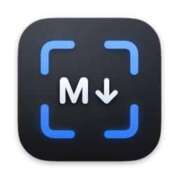
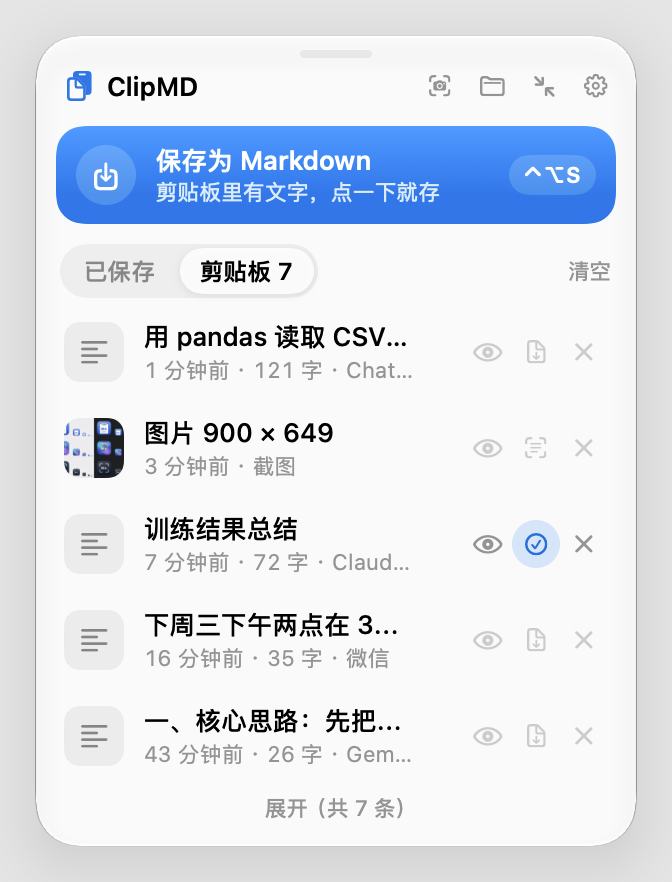
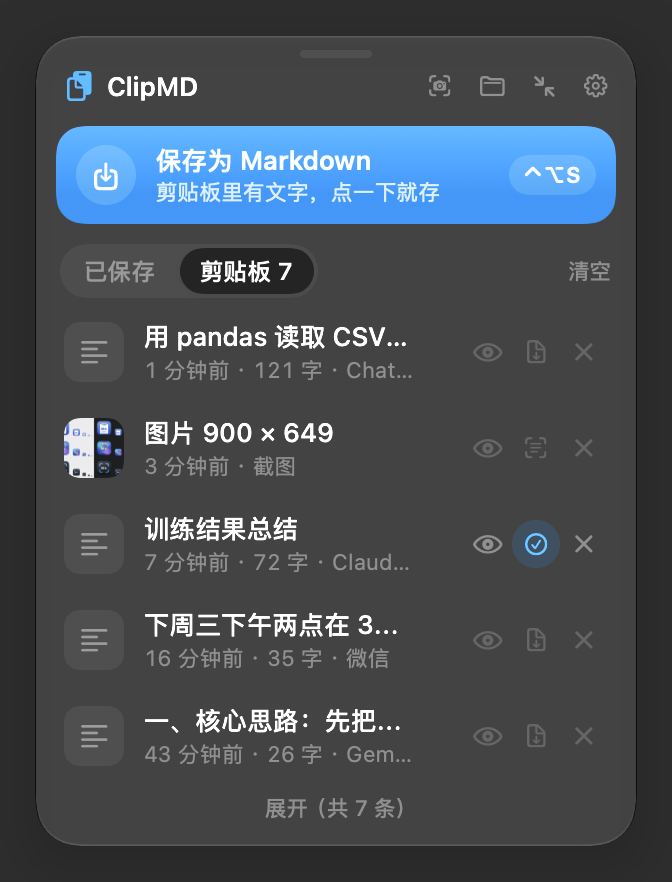
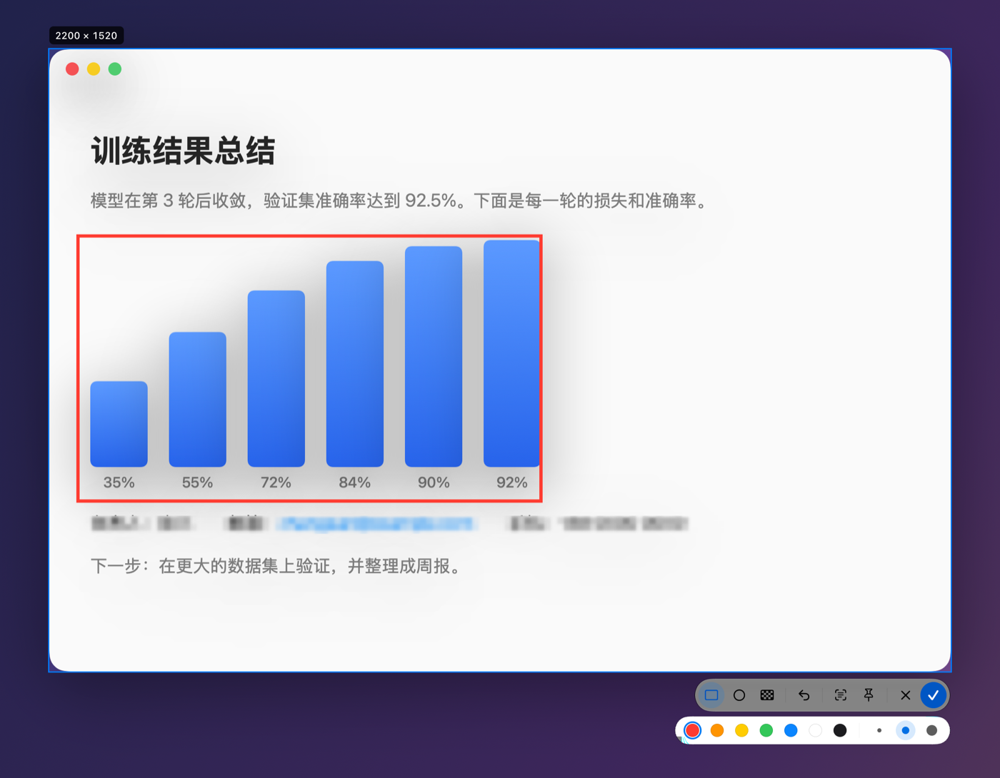
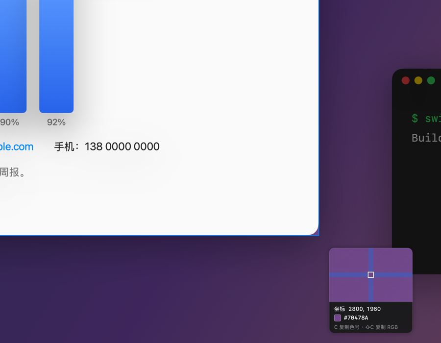

<p align="center">
  
</p>

<h1 align="center">ClipMD</h1>

<p align="center">
  复制 AI 的回复，一键存成 Markdown 文件，直接 ⌘V 发给别人。<br>
  顺手截图、标注、取色、识别文字。原生 macOS，轻量、快、不联网。
</p>

<p align="center">
  
  
  
  
</p>

<p align="center">
  
  &nbsp;&nbsp;
  
</p>

## 为什么做这个

和 ChatGPT、Claude、Gemini 聊完，常常想把一段回复存下来，或者发给同事。直接粘贴到微信里格式全乱，存成文件又要开编辑器、起名字、选位置。

ClipMD 常驻在屏幕边上：复制之后按一下 **⌃⌥S**，内容就存成 `.md` 文件，**文件本身**同时放回剪贴板，到微信、飞书、邮件里 ⌘V，发出去的就是一个 Markdown 附件。

## 功能

### 📋 剪贴板 → Markdown

- **一键保存**：点悬浮窗里的「保存为 Markdown」或按 **⌃⌥S**；也可以**连点两次复制**（同一段文字 3 秒内复制两次）直接保存，误触可以撤销
- **网页内容转 Markdown**：在网页上选中复制，会保留标题、列表、代码块、表格、链接、引用、任务列表，连 ChatGPT（KaTeX）和维基百科（MathML）里的公式也会取出 LaTeX 原文
- **拖进来就存**：把选中的文字或 `.md` `.txt` `.html` `.rtf` 文件拖到悬浮窗上，上半块存成 Markdown，下半块只放进剪贴板
- 文件按「日期 标题.md」命名，默认存在 `~/文稿/ClipMD/`，可以改成 Obsidian 库之类的位置

### 🗂 剪贴板记录

- 复制过的**文字和图片**先记下来（最多 50 条），不存成文件；需要时一键存成 md，图片一键识别文字
- **预览**：文字可以切换「排版」（按 Markdown 显示）和「原文」，图片看大图
- 密码管理器复制的内容、ClipMD 自己写进剪贴板的内容不记；删除、清空都能撤销

### 📝 预览和编辑

- 「已保存」列表里单击就是复制文件，拖进聊天窗口直接发送，拖到废纸篓就是删除
- 内置预览窗口：**预览 / 编辑 / 并排**三种模式，停止输入后自动保存
- **LaTeX 公式**原生渲染（`$…$`、`$$…$$`），不嵌网页；也可以改成用 Typora、VS Code 打开

### ✂️ 截图（⌃⌥A）

<p align="center">
  
</p>

- **自动认出窗口**：鼠标移到哪个窗口就选中哪个，选区外面变暗；也可以自己拖一块
- 左上角**实时显示分辨率**，选好后可以拖动、拖边角调整
- **标注**：矩形、椭圆、马赛克，7 种颜色、3 种粗细，⌘Z 撤销
- **钉在桌面**：截图浮在所有窗口上面，方便对照；滚轮缩放，双击关掉
- 完成后放进剪贴板，同时留在剪贴板记录里

<p align="center">
  
</p>

- **放大镜取色**：选区时鼠标旁边有放大镜，显示像素坐标和 `#RRGGBB` 色号，按 **C** 复制色号，**⇧C** 复制 `rgb(…)`

### 🔤 识别文字（⌃⌥O）

- 框一块区域就识别里面的文字，放进剪贴板；支持简体、繁体中文和英文，中英混排也准
- 用的是系统自带的 Vision，**完全在本机**，不上传任何图片

### ✨ 细节

- 悬浮窗用 Liquid Glass，可以拖动、贴边收起（鼠标移过去再探出来）、固定位置
- 外观可以选**跟随系统 / 浅色 / 深色**
- 三个快捷键都能在设置里改

## 快捷键

| 快捷键 | 作用 |
|---|---|
| ⌃⌥S | 把剪贴板存成 Markdown |
| ⌃⌥A | 截图 |
| ⌃⌥O | 截图并识别文字 |
| 连点两次 ⌘C | 直接保存（可在设置里关掉） |

截图界面里：`R` 矩形、`O` 椭圆、`M` 马赛克、`T` 识别文字、`P` 钉在桌面、`C` 复制色号、`⌘Z` 撤销、回车完成、`Esc` 取消。

## 性能

性能是这个项目的第一要求，下面是在 Apple 芯片的 Mac 上实测的数字：

| | |
|---|---|
| 常驻内存 | 约 30 MB |
| 闲置 CPU | 0.0%～0.1% |
| 安装包 | 3 MB（公式字体按需下载 0.8 MB） |
| 识别文字 | 一般 0.3 秒；识别模型放在用完就退出的子进程里，主程序内存不会涨 |
| 截图 | 关掉截图界面后，整屏画面占的内存全部还给系统 |

做法和更多数字见 [详细说明](docs/GUIDE.md#性能)。

## 安装

**要求**：macOS 26 或更新版本。

### 下载

到 [Releases](https://github.com/NuistLinf/ClipMD/releases) 下载 `ClipMD-x.y.z.zip`，解压后把 `ClipMD.app` 拖进「应用程序」。

ClipMD 没有用苹果开发者证书签名，第一次打开时 macOS 会拦一下：到「系统设置 → 隐私与安全性」最下面点「仍要打开」就行。

### 从源码编译

只需要 Command Line Tools（`xcode-select --install`），不需要 Xcode：

```bash
git clone https://github.com/NuistLinf/ClipMD.git
cd ClipMD
./scripts/install.sh    # 编译、装进「应用程序」并打开
```

其他脚本：`./scripts/build-app.sh` 只编译成 `build/ClipMD.app`，`./scripts/test.sh` 跑单元测试，`./scripts/make-icon.sh` 重新生成图标。

### 第一次用

ClipMD 会用到这几个系统权限，按提示允许即可：

- **粘贴**：读取剪贴板内容。建议在「隐私与安全性 → 粘贴」里设成「允许」，不然每次保存都会问
- **文稿文件夹**：默认保存位置在这里
- **录屏与系统录音**：截图要用，打开后要重启一次 ClipMD

## 隐私

所有内容都在本机处理：剪贴板记录存在 `~/Library/Application Support/ClipMD/`，截图、识别文字都不联网。唯一会联网的是在预览里点「下载公式字体」，从 GitHub 上 SwiftMath 的固定版本下载，并逐个校验 SHA-256。

## 详细说明

每个功能的细节、实现方式、性能测试和调试方法，都写在 [docs/GUIDE.md](docs/GUIDE.md)。

## 致谢

- [SwiftMath](https://github.com/mgriebling/SwiftMath)（MIT）：原生绘制 LaTeX 公式，源码放在 `Vendor/`
- Latin Modern Math 字体（GUST Font License）：按需下载，不随安装包分发

## 许可

[MIT](LICENSE)
